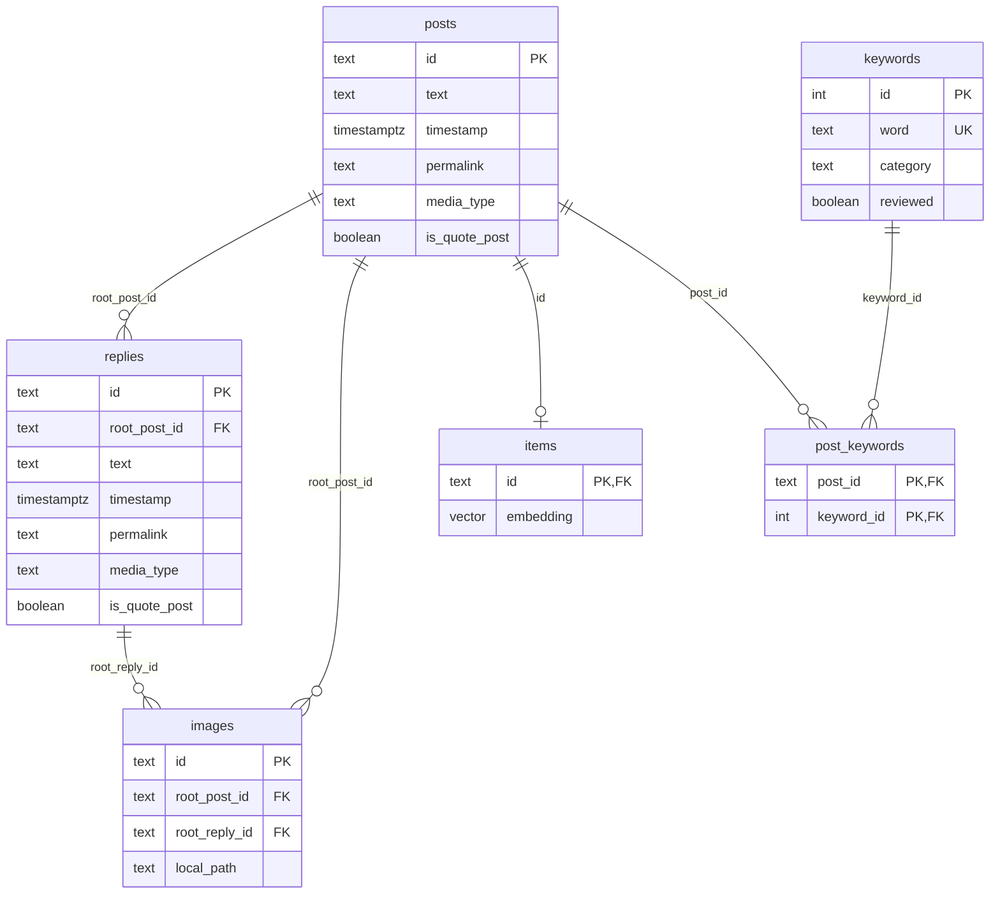

# embedding-brownian-motion
[](https://www.threads.net/@brownian.motion.99)

This repository is for building text corpus snapshots from a pgvector database for a discord chat bot.

The source of text corpus is the science communication series 《每天分享一個大氣科學知識直到我沒梗》 on threads. The posts are retrieved through threads api (see [threads-backup](https://github.com/Brownian-Motion-99/threads-backup.git)), and stored in a pgvector database. Because the scale of text corpus is relatively small (~ 60k words, 80k tokens estimated by Claude Haiku 4.5), the semantic searching is currently implemented with NumPy instead of pgvector database.

This repository has four main components:

1. ```pgvector database```: storing data (embedding text, embedding vectors, etc.)

2. ```embedding.py```: assembling the embedding text, generating embedding vectors.

3. ```snapshot.py```: building snapshots for discord bot.

4. ```examine_snapshot.ipynb```: examining if the snapshot is correctly built.

## pgvector database


- ```posts```: Main bodies of posts.
- ```replies```: Replies of a given post.
- ```images```: Images in a given post.
- ```keywords```: Keywords for classifaction and tagging.
- ```post_keywords```: Keywords tagged in a given post.
- ```items```: Embedding vectors.

## Embedding

The embedding is conducted following this procedure:

1. Fetching all of the posts and replies from pgvector database.

2. Assembling posts and replies as embedding text.

3. Generating embedding vectors using ```gemini-embedding-001```.

4. Writing embedding vectors into pgvector database.

Details can be found in [```embedding.py```](./embedding.py).

## Generating pgvector database snapshot

The database snapshot is composed of three parts:

1. ```chunks.jsonl```: Embedding chunks, each chunk contains one post.

2. ```vectors.npy```: Embedding vectors.

3. ```manifest.json```: Configuration of the snapshot.

Details can be found in [```snapshot.py```](./snapshot.py).

**Note**: the snapshot is exported into a private repository in order to prevent potential data leaks.

## Examining snapshot

Examining if the pgvector database snapshot is built correctly. The examination focuses on:

1. If the order of ```chunks.jsonl``` and ```vectors.npy``` are aligned.

2. If the semantic searching works as expectation.

Details can be found in [```examine_snapshot.ipynb```](./examine_snapshot.ipynb).

**Note**: Post IDs are not stored together with embedding vectors, hence examining the order of ```chunks.jsonl``` and ```vectors.npy``` is necessary.
